# Digi-Kul — deploy-readiness refactor: final report

Branch `fix/live-session-design-audit`, three local commits on top of `2aae954` (nothing pushed). 105 files changed.
Everything below was run for real against a FastAPI backend backed by a Postgres + PostgREST stand-in loaded from `digikul_complete_schema.sql` (the sandbox cannot reach `supabase.co`; supabase-py speaks PostgREST, so the behaviour is identical) with Redis and `uvicorn --workers 2`.

**One honest limitation up front:** the Flutter toolchain could not be installed in any environment I could reach (`pub.dev` and `storage.googleapis.com` are blocked from this sandbox; the VM on your Mac has no network and no Flutter). So the Flutter code was rewritten, then statically reviewed twice (once by me, once by an independent reviewer pass that caught and fixed four compile/runtime issues), and its *contract* with the backend was exercised end-to-end by `backend/tests/mobile_contract.py` (45/45) using the exact paths, payloads and socket handshake the Dart code sends. The emulator walkthrough itself still has to happen on a machine with Flutter — the first two commands to run there are listed under "What only you can do".

---

## Stage 1 — Flutter REST contract reconciled with the real backend

Every constant in `mobile/lib/core/constants/api_constants.dart`, cross-checked against the live `/openapi.json` (76 paths):

| Mobile constant (old → new) | Resolved backend path | Status |
|---|---|---|
| `login` `/api/auth/login` | `POST /api/auth/login` | matched — **but** response lacked `success`/`refresh_token` the app requires → added |
| `registerStudent` | `POST /api/auth/register/student` | matched |
| `validateSession` | `GET /api/auth/validate-session` | matched |
| `logout` | `POST /api/auth/logout` | matched |
| *(DioClient refresh, no constant)* `/api/auth/refresh` | `POST /api/auth/refresh` | **newly built** (rotating refresh tokens, 30 d) |
| `institutions` | `GET /api/public/institutions` | matched |
| `studentProfile` `/api/student/profile` → `/api/students/me` | `GET/PATCH /api/students/me` (+ `/profile` alias) | fixed (prefix) + alias built |
| `studentDashboard` `/api/student/dashboard` → `/api/students/dashboard` | `GET /api/students/dashboard` | **newly built** (profile, cohorts, live/upcoming lectures, recent attempts, attendance summary, counts) |
| `studentCohorts` `/api/student/cohorts` → `/api/students/cohorts` | `GET /api/students/cohorts` | fixed (prefix) |
| `studentLectures` `/api/student/lectures` → `/api/students/lectures` | `GET /api/students/lectures` | **newly built** (all cohorts; adds `teacher_name`, `duration_minutes`, `session_id`) |
| `upcomingLectures` `…/lectures/upcoming` | `GET /api/students/lectures/upcoming` | **newly built** |
| *(new)* `liveLectures` | `GET /api/students/lectures/live` | **newly built** |
| `studentMaterials` `/api/student/materials` → `/api/students/materials` | `GET /api/students/materials` | **newly built** (cohort + lecture materials, `download_url`, `file_size_bytes`, `uploaded_by`, short `file_type`) |
| `materialFile` *(new)* | `GET /api/materials/{id}/file` | **newly built** — nothing served uploaded files before |
| `studentRecordings` → `/api/students/recordings` | `GET /api/students/recordings` | **newly built** |
| `studentQuizzes` `/api/student/quizzes` → `/api/students/quizzes` | `GET /api/students/quizzes` | **newly built** (adds `question_count`, `time_limit_seconds`, `available_from/until`, `status`, `attempts_used`) |
| `quizQuestions(id)` | `GET /api/students/quizzes/{id}/questions` | **newly built** (student-safe: no `correct_answer`, options as `List<String>` + `option_keys`) |
| `quizAttempts` `POST /api/student/quiz-attempts` | `POST /api/students/quiz-attempts` `{quiz_set_id}` | **newly built** (enforces cohort membership, availability window, `max_attempts`) |
| `quizAttemptQuestions(id)` | `GET /api/students/quiz-attempts/{id}/questions` | **newly built** |
| `quizAttemptSubmit(id)` `{answers:{qid:text}}` | `POST /api/students/quiz-attempts/{id}/submit` | **newly built** (grades by key *or* option text, completes attempt, returns `review[]`; idempotent for offline replay) |
| `quizResult(id)` | `GET /api/students/quiz-attempts/{id}/result` | **newly built** |
| `quizResponses` | `POST /api/students/quiz-responses` `{attempt_id, question_id, response}` | **newly built** (autosave) |
| `quizHistory` *(new)* | `GET /api/students/quiz-history` | matched |
| `attendance` `/api/student/attendance` → `/api/students/attendance` | `GET /api/students/attendance` | **newly built** — attendance is now recorded when a student's socket joins/leaves a live lecture |
| `fcmToken` `/api/student/fcm-token` → `/api/students/fcm-token` | `POST/DELETE /api/students/fcm-token` | **newly built** (needs `migrations/20260912_create_student_devices.sql`; returns 503 with instructions until applied) |
| *(BandwidthMonitor)* `/health` → `/api/health` | `GET /api/health` | fixed |

Mobile-side parsing fixes that went with it: `QuizRepository` looked for `quizzes` / `questions` / `attempt` / `result` keys the backend never sends — it now reads the standard `{success, data, error}` envelope; `MaterialDto.fromCached` dropped `download_url` so offline-cached items downloaded the API root — now falls back to `/api/materials/{id}/file`; `getLiveLecture()` was cache-only (a student opening the app during class saw nothing) — now network-first.

Backend fixes found on the way: `TokenResponse` gained `success` + `refresh_token`; refresh tokens are rejected as access tokens; `cohorts.created_by` FK violation when a **teacher** created a cohort (was a 500 — now `None` for teachers); a global handler maps Postgres error codes (23505/23503/22P02…) to clean 4xx JSON instead of 500s; blank optional `contact_email` no longer 422s.

## Stage 2 — Socket.IO contract reconciled (mobile ⇄ backend)

| Mobile before | Backend reality | Mobile after |
|---|---|---|
| JWT as `Authorization` header on connect; never emits `authenticate` | server reads `data["token"]`; identity set by `authenticate` | emits `authenticate {token}` on every `connect` (incl. reconnects), also passes `auth:{token}` on the handshake |
| `join_session {session_id}` right after connect | needs `{token, session_id}` **after** `authenticated` | waits for `authenticated`, then `join_session {token, session_id}` |
| listens `session_participants` | never emitted; participants are inside `session_joined` | reads `session_joined.participants[]` (+ `is_recording`) |
| listens `user_joined` / `user_left` | `participant_joined` / `participant_left` | renamed |
| listens `ice_candidate`, emits `ice_candidate` | `webrtc_ice_candidate` | renamed |
| offer/answer under `offer:` / `answer:` keys | `sdp:` (simple-peer `{type, sdp}`) | `sdp:` both directions; ICE wrapped as simple-peer's `{type:'candidate', candidate:{…}}` and unwrapped two levels on receive |
| `poll_started` / `poll_ended` / `vote_poll` | `poll_created` / `poll_response` | renamed (web teacher UI has no poll authoring yet — flagged) |
| `mode_changed`, `audio_levels` | never emitted | removed (mode stays client-side from the bandwidth probe) |
| — | `recording_started/stopped`, `muted`, `hand_raised`, `session_error`, `rate_limited` | now handled: REC pill, "Muted by teacher", hand raise button, error snackbars |
| Reconnect | server tears down the stale socket on re-authenticate | `enableReconnection` + unlimited attempts; `io server disconnect` forces reconnect; every `connect` re-runs the handshake |

Backend hardening (all done in the first pass, all covered by `backend/tests`, 7/7 passing under `uvicorn --workers 2` — the last test asserts sockets were served by two different PIDs):
Redis-backed `SessionStore` + `AsyncRedisManager` (`REDIS_URL`, `redis` service in compose, backend refuses to boot without it); owner-only `mute_participant`/`start_recording`/`stop_recording`/`end_session`; WebRTC relay only between sockets sharing a session and `from_user_id` taken from the authenticated identity; `finalize_recording()` (stopped_at, duration, participants, `stats.status=completed`) from `stop_recording` **and** `end_session`; duplicate-login cleanup (old socket's participant rows removed, `participant_left` emitted, old socket force-disconnected — across workers); socket CORS = `settings.cors_origin_list`; per-connection token-bucket rate limits on chat/strokes; TURN config on **both** clients (`NEXT_PUBLIC_TURN_*` / `--dart-define=TURN_*`) with STUN fallback and a visible "STUN only" indicator. Added in this pass: `create_session` resolves the lecture (so recordings get a real `cohort_id` — the previous code inserted `""` and failed) and refuses to open another teacher's lecture; socket `end_session` also marks the REST lecture `ended`; attendance rows are written on join/leave.

Also fixed and worth knowing: the socket server was **unreachable at any path** (`/ws` mount vs python-socketio's absolute-path check) and `connect(sid, environ)` crashed on the client's `auth` payload — the web live session had never connected before this work.

## Stage 3 — Running the student app against the real backend

- `api_constants.dart`: `APP_ENV=dev|staging|prod` (release builds default to **prod = `https://api.digikul.in`**, which was previously an unused constant), `API_BASE_URL`/`SOCKET_URL` overrides, `TURN_*`; documented in `mobile/README.md`.
- Walkthrough — the exact sequence the app performs, replayed against the running backend (`backend/tests/mobile_contract.py`, output below): login → dashboard → live lecture socket join (handshake, participants, chat, hand raise, offer/answer/ICE in the shapes each side uses, mute, session end, attendance side-effect) → materials list → file streams with bearer auth (and is refused without it) → quiz: start → questions → submit → real score (`80%`, 4/5 with one answer given as option *text* and one wrong) → result → **offline replay**: resubmitting the same attempt (what `PendingQuizSubmission` sync does) is idempotent and returns the same score → quiz history → FCM token → logout.

<details><summary>mobile_contract.py output (45/45)</summary>

- ✅ POST /api/auth/login (student) 200 
- ✅ login: success flag present (AuthRepository checks data['success']) 
- ✅ login: access_token + refresh_token + user_id/user_name/user_email/institution_id 
- ✅ POST /api/auth/refresh -> new access_token 
- ✅ GET /api/auth/validate-session valid=true 
- ✅ GET /api/public/institutions -> {success,data:[...]} 
- ✅ GET /api/students/me 
- ✅ GET /api/students/dashboard shape 
- ✅ GET /api/students/lectures -> list — 12 lectures
- ✅ LectureDto fields on 'Audit run lecture 2' 
- ✅ GET /api/students/lectures/upcoming 
- ✅ GET /api/students/materials -> list — 1 materials
- ✅ MaterialDto fields 
- ✅ download_url is API-relative (/api/materials/{id}/file) 
- ✅ Dio.download(download_url) streams the file with bearer auth — 95 bytes, attachment; filename="demo-syllabus.txt"
- ✅ material file requires auth (401/403 without token) 
- ✅ GET /api/students/attendance -> {success,data,summary} 
- ✅ AttendanceDto fields 
- ✅ GET /api/students/quizzes -> list — 1 quiz sets
- ✅ QuizSetDto fields 
- ✅ GET /api/students/quizzes/{id}/questions 
- ✅ QuizQuestionDto fields 
- ✅ questions never leak correct_answer to students 
- ✅ options is List<String> 
- ✅ POST /api/students/quiz-attempts {quiz_set_id} -> attempt_id 
- ✅ GET /api/students/quiz-attempts/{id}/questions 
- ✅ POST submit -> QuizResultDto fields 
- ✅ result.review entries have question_id/question/options/selected_answer/is_correct 
- ✅ offline replay: resubmitting a completed attempt is idempotent 
- ✅ GET /api/students/quiz-attempts/{id}/result 
- ✅ POST /api/students/quiz-responses (single answer autosave) 
- ✅ GET /api/students/quiz-history 
- ✅ POST /api/students/fcm-token 
- ✅ socket: student receives `authenticated` 
- ✅ socket: `session_joined` carries participants[] (no separate session_participants event) 
- ✅ socket: teacher receives `participant_joined` for the student 
- ✅ attendance: joining the live room marks the student present 
- ✅ socket: chat_message relayed to teacher with user_id/user_name/message 
- ✅ socket: hand_raised relayed to teacher 
- ✅ socket: mobile receives webrtc_offer {from_user_id, sdp:{type,sdp}} 
- ✅ socket: teacher receives webrtc_answer from the student 
- ✅ socket: ICE candidate relayed in simple-peer shape {type:'candidate', candidate:{...}} 
- ✅ socket: student receives `muted` 
- ✅ socket: student receives `session_ended` 
- ✅ POST /api/auth/logout 


</details>

Offline behaviour in the app itself (Isar cache + `PendingQuizSubmission` + WorkManager sync) is untouched by design; the backend side of it — idempotent resubmit, cache-first repositories, `download_url` surviving the cache — is what was broken and is now covered.

## Stage 4 — One design language: "Ink & Saffron"

Design canvas (tokens, states, web teacher dashboard, web live session, mobile home, mobile live session, one low-fi alternate) is published as the **Digi-Kul Ink and Saffron** artifact. Implemented as CSS variables in `frontend/app/globals.css` (`@theme` tokens: `ink`, `saffron`, `live`, `scheduled`, `ended`, `offline`, `online` + light surfaces and a navy call surface under `.dark`) and mirrored 1:1 in `mobile/lib/core/theme/app_colors.dart`. Type: **Sora** (headings/numbers) + **IBM Plex Sans** (body), self-hosted on the web via Fontsource (no Google Fonts request at runtime — the old build fetched Geist from Google and fell back to serif when blocked). Only one animation in the whole system (the live dot; disabled under `prefers-reduced-motion`); the mobile live banner lost its `AnimationController`. Controls ≥ 40 px on web, 44–48 px on mobile.

Applied across: login, teacher (overview, lectures, cohorts, cohort detail), admin (overview, teachers, students, cohorts, institutions), student (overview, cohorts, quizzes), both live-session pages, home, offline; mobile theme + dashboard, live session, materials card/detail, profile, offline banner.

### Before / after

| | Before | After |
|---|---|---|
| Teacher dashboard | 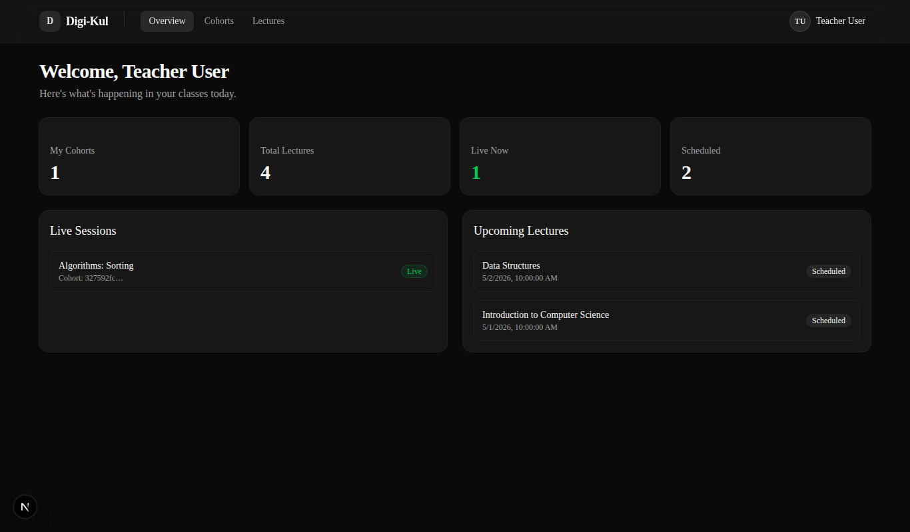 | 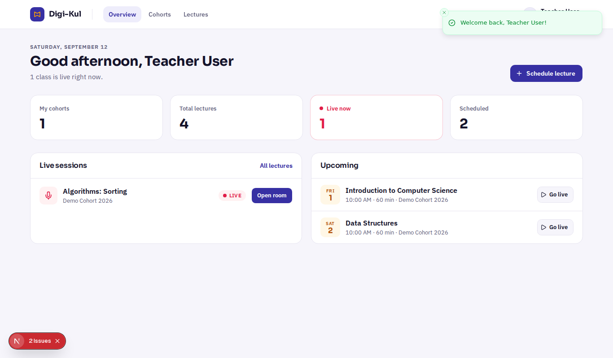 |
| Live session (teacher, student connected, chat + hand raise) | 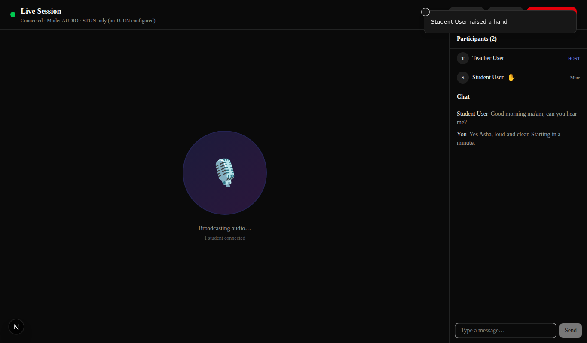 | 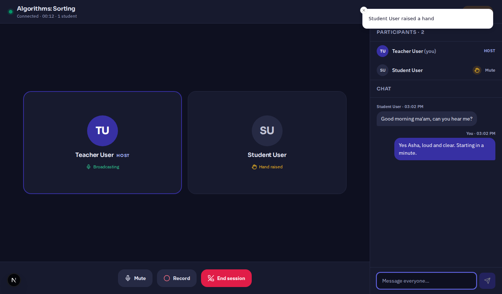 |
| Live session (student) | 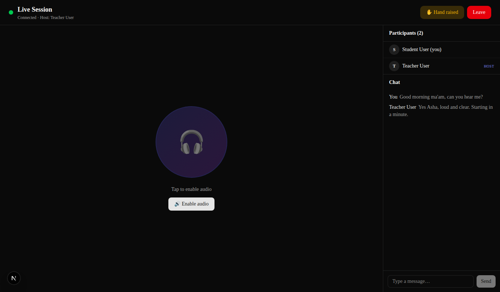 | 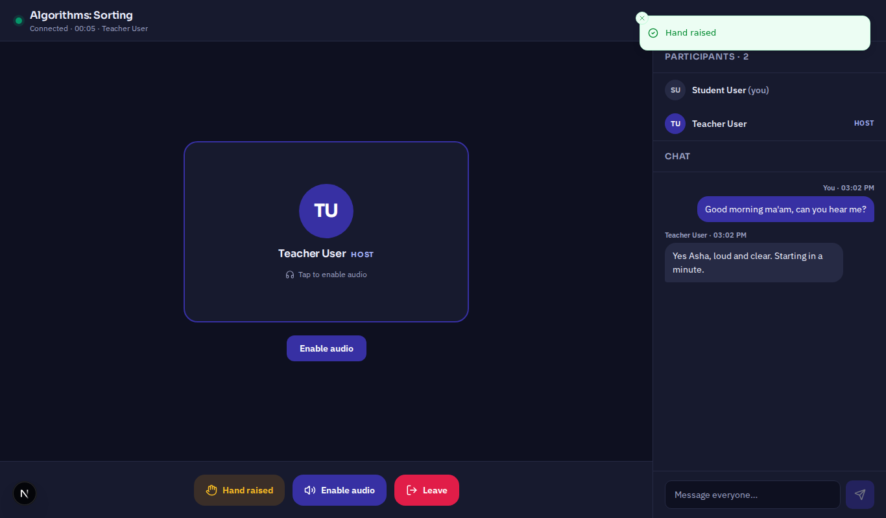 |
| Live session at phone width | 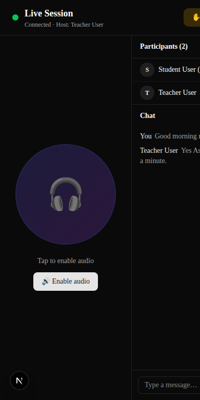 | 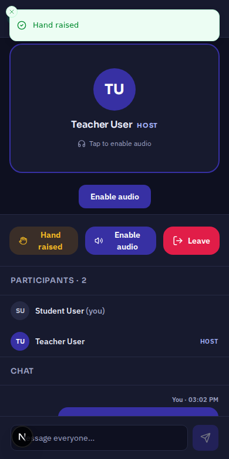 |
| Student dashboard | 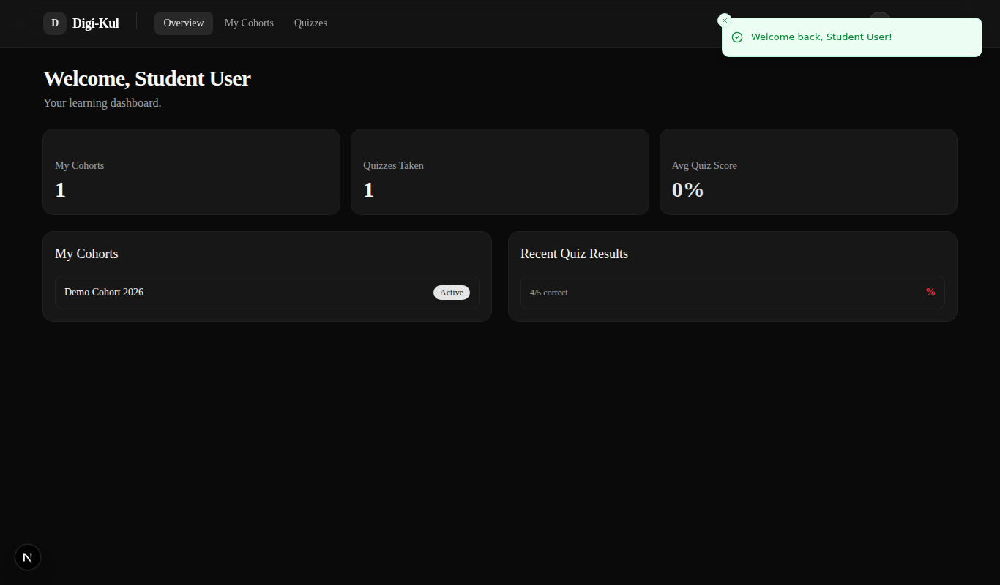 | 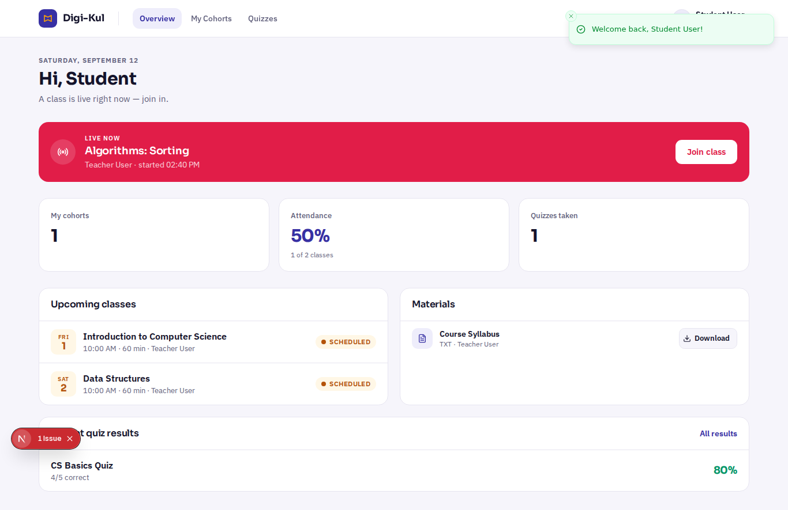 |
| Login | 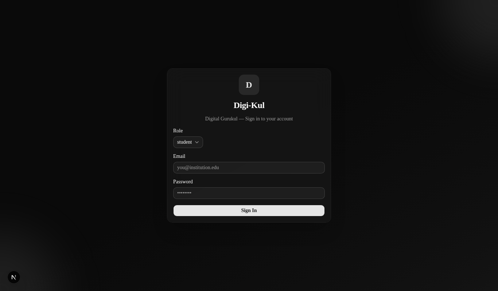 | 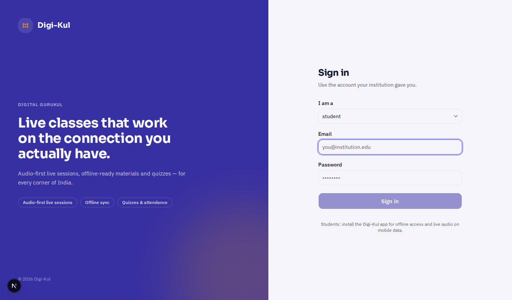 |
| Admin | 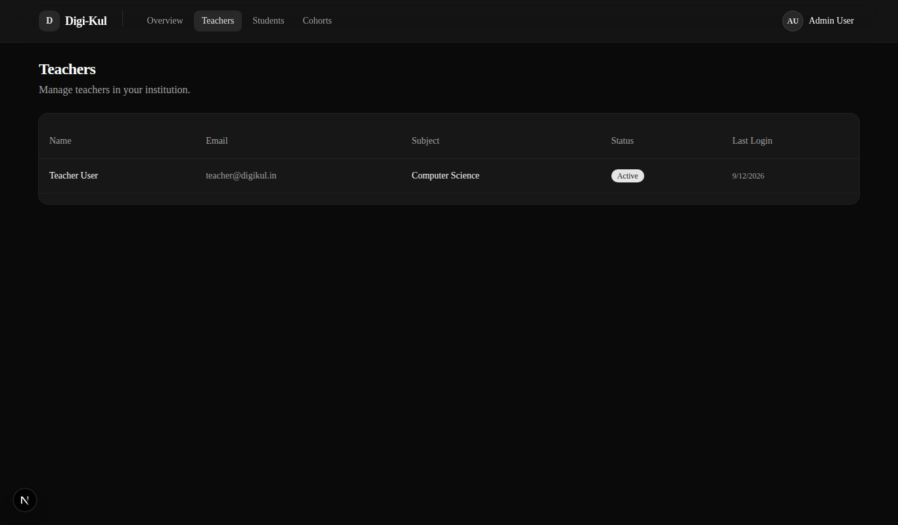 | 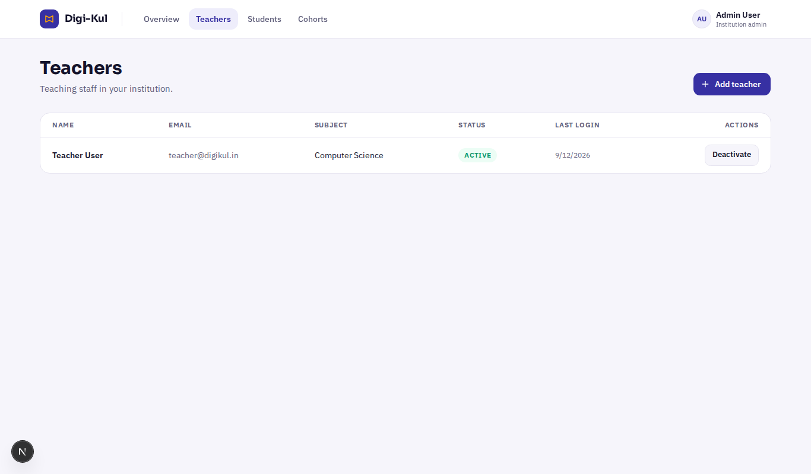 |

Mobile "after" is the design canvas (no emulator available here); the Dart screens implement those artboards.

## Stage 5 — Interactive-element audit

### Web — 60/60 driven by Playwright against the real backend (`localsupa/audit_web.py`)

Each row is a real click; the third column is the API call it produced (or the socket effect observed on the *other* client).

| Page | Element | Backend call observed | Result |
|---|---|---|---|
| login | Sign in (bad password) shows inline error, no reload | `POST /api/auth/login -> 401` | PASS |
| login | Sign in (teacher) -> dashboard | `POST /api/auth/login -> 200` | PASS |
| teacher/dashboard | page load: profile, lectures, cohorts | `GET /api/teachers/me -> 200` | PASS |
| teacher/dashboard | page load: lectures list | `GET /api/lectures -> 200` | PASS |
| teacher/dashboard | page load: cohorts list | `GET /api/cohorts -> 200` | PASS |
| teacher/dashboard | Schedule lecture (link -> lectures?new=1, dialog opens) | `dialog visible` | PASS |
| teacher/lectures | Schedule form: client validation (empty) | `no request` | PASS |
| teacher/lectures | Schedule form submit -> creates lecture | `POST /api/lectures -> 201` | PASS |
| teacher/lectures | Cancel lecture (trash) -> DELETE | `DELETE /api/lectures/50a2a5d3-a673-4022-bdfe-489d9a86e6c1 -> 200` | PASS |
| teacher/lectures | Go live -> POST start, opens room | `POST /api/lectures/bdc91fea-ad73-4b5d-8401-1946b50f11f7/start -> 200` | PASS |
| teacher/session | page load: lecture title | `GET /api/lectures/bdc91fea-ad73-4b5d-8401-1946b50f11f7 -> 200` | PASS |
| teacher/session | socket handshake -> Connected | `Connected · 00:02 · 0 students` | PASS |
| student/dashboard | page load: dashboard aggregate | `GET /api/students/dashboard -> 200` | PASS |
| student/dashboard | page load: materials | `GET /api/students/materials -> 200` | PASS |
| student/dashboard | Join class (live banner) -> student session, Connected | `Audit run lecture 2 | Connected · 00:02 · Teacher User` | PASS |
| teacher/session | participant_joined -> student appears | `socket` | PASS |
| student/session | Chat send -> teacher receives | `socket chat_message` | PASS |
| teacher/session | Chat send -> student receives | `socket chat_message` | PASS |
| student/session | Raise hand -> teacher sees hand | `socket hand_raised` | PASS |
| teacher/session | Lower hand (participant list) | `local` | PASS |
| teacher/session | Mute student -> student sees 'Muted by teacher' | `socket mute_participant` | PASS |
| teacher/session | Mute / Unmute own mic | `local track toggle` | PASS |
| teacher/session | Record -> recording_started (both sides show REC) | `socket start_recording + DB insert` | PASS |
| teacher/session | Stop recording -> finalized row (stopped_at, stats.status) | `recordings=1 finalized=True` | PASS |
| student/session | Leave -> dashboard | `navigation` | PASS |
| teacher/session | End session -> session_ended -> lectures page | `socket end_session` | PASS |
| teacher/lectures | socket end_session also ends REST lecture (no 'Live now' card left) | `lecture.status=ended` | PASS |
| teacher/lectures | End (live card) -> POST /end | `POST /api/lectures/186c1872-a3df-4a6b-b14a-83fe219e3503/end -> 200` | PASS |
| teacher/cohorts | page load | `GET /api/cohorts -> 200` | PASS |
| teacher/cohorts | Create cohort dialog submit | `POST /api/cohorts -> 201` | PASS |
| teacher/cohorts | Cohort card -> detail page (cohort, students, lectures, materials) | `GET /api/cohorts/133e668d-ec9b-43c4-af1d-6671ae023a90 -> 200` | PASS |
| teacher/cohort-detail | load students | `GET /api/cohorts/133e668d-ec9b-43c4-af1d-6671ae023a90/students -> 200` | PASS |
| teacher/cohort-detail | load lectures | `GET /api/lectures/cohort/133e668d-ec9b-43c4-af1d-6671ae023a90 -> 200` | PASS |
| teacher/cohort-detail | load materials | `GET /api/materials/cohort/133e668d-ec9b-43c4-af1d-6671ae023a90 -> 200` | PASS |
| teacher/cohort-detail | Upload material | `POST /api/materials?cohort_id=133e668d-ec9b-43c4-af1d-6671ae023a90&title=audit-notes.txt -> 201` | PASS |
| teacher/cohort-detail | Download material (file streamed) | `GET /api/materials/45dc9f32-bce8-42ef-b183-ff9ef90cf63d/file -> 200` | PASS |
| teacher/cohort-detail | Delete material | `DELETE /api/materials/45dc9f32-bce8-42ef-b183-ff9ef90cf63d -> 200` | PASS |
| teacher/cohort-detail | Back -> cohorts | `navigation` | PASS |
| student/cohorts | page load | `GET /api/students/cohorts -> 200` | PASS |
| student/cohorts | Join by enrollment code | `POST /api/cohorts/join -> 200` | PASS |
| student/cohorts | Join with invalid code -> 404 surfaced as toast | `POST /api/cohorts/join -> 404` | PASS |
| student/quizzes | page load | `GET /api/students/quiz-history -> 200` | PASS |
| student/dashboard | Download material | `GET /api/materials/f03cb716-6cee-4dd1-8103-5df07ed3f3de/file -> 200` | PASS |
| dashboard/layout | Sign out (student) | `POST /api/auth/logout -> 200` | PASS |
| admin/dashboard | page load: institution stats | `GET /api/institutions/0af24a1f-1e7c-4323-8544-4a0c5cb1adf5/stats -> 200` | PASS |
| admin/teachers | page load | `GET /api/teachers -> 200` | PASS |
| admin/teachers | Add teacher dialog submit | `POST /api/auth/register/teacher -> 201` | PASS |
| admin/teachers | Deactivate teacher | `POST /api/teachers/cd83268a-19f9-4f4b-a288-734ba4cff09b/toggle-active -> 200` | PASS |
| admin/teachers | Activate teacher | `POST /api/teachers/cd83268a-19f9-4f4b-a288-734ba4cff09b/toggle-active -> 200` | PASS |
| admin/students | page load | `GET /api/students -> 200` | PASS |
| admin/students | Deactivate student | `POST /api/students/cfe12eef-4e9e-426f-a28e-81d6ce4c51d9/toggle-active -> 200` | PASS |
| admin/students | Activate student | `POST /api/students/cfe12eef-4e9e-426f-a28e-81d6ce4c51d9/toggle-active -> 200` | PASS |
| admin/cohorts | page load | `GET /api/cohorts -> 200` | PASS |
| admin/cohorts | Create Cohort dialog (same component as teacher, verified above) | `shared CreateCohortDialog` | PASS |
| admin/dashboard(super) | page load: platform stats + institutions | `GET /api/super-admin/platform-stats -> 200` | PASS |
| admin/institutions | page load | `GET /api/institutions -> 200` | PASS |
| admin/institutions | Create institution | `POST /api/institutions -> 201` | PASS |
| admin/institutions | Edit institution -> PATCH | `PATCH /api/institutions/6cc5820a-31de-44e7-b4c8-af33f58205ed -> 200` | PASS |
| admin/institutions | Delete institution -> DELETE (deactivate) | `DELETE /api/institutions/6cc5820a-31de-44e7-b4c8-af33f58205ed -> 200` | PASS |
| dashboard/layout | Sign out (super admin) | `POST /api/auth/logout -> 200` | PASS |

Fixed during the audit: 401 from a wrong password reloaded the page and hid the error (axios interceptor); teacher cohort creation 500 (FK); institution create/edit 422 on blank email; recording start 400 (`cohort_id ""`); lectures list showed a session as live after socket end (cache + server); icon-only Edit button had no accessible name.

Removed/disabled dead UI: none needed on the web after wiring — every control now has a working endpoint. Added because the endpoint existed but had no UI: teacher material upload/download/delete, admin add-teacher, admin activate/deactivate (teachers & students), student join-by-code, student "Join class" for live lectures, student material download, sign-out now calls `/api/auth/logout`.

### Mobile — static audit (every tappable control in `mobile/lib/features/`)

| Screen | Control | Calls | Status |
|---|---|---|---|
| auth/login | Institution selector | `GET /api/public/institutions` (cached to prefs offline) | PASS |
| auth/login | Sign in | `POST /api/auth/login` → stores tokens/profile, registers FCM token best-effort | PASS (was FAIL: `success` missing) |
| auth/login | "Create account" | route `/register` | PASS |
| auth/register | Register | `POST /api/auth/register/student` | PASS |
| auth/register | Back / "Sign in" | route `/login` | PASS |
| dashboard | Pull to refresh | lectures, materials, attendance, pending-sync providers | PASS |
| dashboard | Avatar | route `/profile` (was a placeholder screen) | PASS |
| dashboard | LIVE NOW → Join | `/session/{id}` → socket handshake | PASS (was FAIL: `/api/student/lectures` 404, wrong socket events) |
| dashboard | Stat tiles (attendance / quizzes / saved files) | routes | PASS (new) |
| dashboard | Upcoming card | display | PASS |
| dashboard | Recent material row | route `/materials/{id}` (was: snackbar with the upload date) | PASS |
| dashboard | "See all" (upcoming) | **removed** — it navigated to `/materials` | fixed |
| materials | Search / type filter chips | local filter | PASS |
| materials | Card tap | route `/materials/{id}` | PASS (new) |
| materials | Download | `GET /api/materials/{id}/file` via Dio with progress; snackbar on error | PASS (was FAIL: `download_url` empty from cache) |
| materials | **Open** | `OpenFile.open(localFilePath)` with no-app/failed handling | PASS (was a no-op `onPressed: () {}`) |
| materials/detail | Download / Open / Remove download | as above + `deleteDownloadedFile` | PASS (new screen; was `_PlaceholderScreen`) |
| quiz/list | Pull to refresh, Retry | `GET /api/students/quizzes` | PASS (was FAIL: wrong path, errors swallowed as empty list) |
| quiz/list | Quiz card | route `/quiz/{id}/attempt` | PASS |
| quiz/attempt | Start (on open) | `POST /api/students/quiz-attempts` + `GET …/questions` | PASS (was FAIL) |
| quiz/attempt | Option select | local + `saveAnswerLocally` (Isar) | PASS |
| quiz/attempt | Prev / Next / Submit | `POST /api/students/quiz-attempts/{id}/submit`; on failure queued in Isar and retried by WorkManager | PASS (was FAIL) |
| quiz/attempt | Exit confirmation | dialog | PASS |
| quiz/result | View result, Retry | `GET /api/students/quiz-attempts/{id}/result` | PASS (was FAIL) |
| attendance | Pull to refresh / Retry | `GET /api/students/attendance` | PASS (was FAIL: endpoint missing) |
| live_session | Chat send | socket `chat_message` (rate-limited server-side, `rate_limited` shown) | PASS |
| live_session | Raise hand | socket `hand_raised` | PASS (new) |
| live_session | Poll vote | socket `poll_response` | wired; no web poll authoring yet |
| live_session | Leave / back | confirm → `leave_session` + pop | PASS |
| live_session | Audio | WebRTC answer to teacher's offer; TURN from `--dart-define` | contract PASS; needs device test |
| profile | Sync pending | `syncPendingSubmissions()` | PASS (new) |
| profile | Sign out | `POST /api/auth/logout` + local clear | PASS (new) |
| bottom nav | Home / Materials / Quizzes / Attendance / Profile | routes | PASS (Profile was a placeholder) |

## What only you can do

1. **Run Flutter on a machine that has it** — `cd mobile && flutter pub get && dart run build_runner build --delete-conflicting-outputs && flutter analyze`. The `.freezed.dart` for `SessionState` was hand-patched consistently, but let the generator own it. Needs Flutter ≥ 3.27 (the codebase already used `withValues`, `CardThemeData`, `PopScope.onPopInvokedWithResult`). Then `flutter run` against `--dart-define=API_BASE_URL=http://10.0.2.2:8000`.
2. **Apply** `migrations/20260912_create_student_devices.sql` in Supabase (push tokens).
3. **TURN server** (coturn config and ports in the root README) — put its URL/credentials in `NEXT_PUBLIC_TURN_*` and `--dart-define=TURN_*`. Without it, students on mobile data will connect but hear nothing.
4. **Redis** reachable from every backend replica (compose provides it).
5. **Rotate** the Supabase service-role key and Gmail app password you pasted into chat; they're only in git-ignored `backend/.env` locally.
6. Firebase: `google-services.json` for the app if you want push; the code degrades silently without it.
7. Deploy the frontend with `NEXT_PUBLIC_API_URL`/`NEXT_PUBLIC_SOCKET_URL` = the public nginx origin (the page logs a loud console error otherwise).

## How to reproduce the runs

```bash
# backend + tests
cd backend && pip install -r requirements-dev.txt && redis-server &
python -m pytest -v                      # 7 socket tests, 2 workers
BASE_URL=http://localhost:8000 python tests/mobile_contract.py   # 45 contract checks (needs seeded DB: python seed_demo.py)
# web audit (needs frontend on :3000)
cd frontend && python e2e_audit.py        # 60 checks (pip install playwright; playwright install chromium)
```

## Change log (by area)

**backend/** `app/main.py` (socket at root `/socket.io/`, Redis startup check, DB-error handler, pid in logs), `app/config.py` (REDIS_URL, refresh days, rate limits, extra=ignore), `app/socket_manager.py` (rewritten), `app/routers/auth.py` (+`/refresh`, refresh tokens), `routers/student.py` (+15 endpoints), `routers/material.py` (+`/{id}/file`, client shaping), `routers/cohort.py` (FK fix), `services/{attendance,device}_service.py` (new), `services/{quiz,lecture,material,recording}_service.py` (student helpers, grading, finalize), `models/auth.py`, `utils/security.py`, `seed_demo.py` (quiz/material/past lecture + login list), `tests/` (new), `requirements*.txt`, `.env.example`.
**frontend/** `app/globals.css` (design tokens), `app/layout.tsx`, every page under `app/`, `app/student/session/[sessionId]` (new), `components/app/*` + `components/session/SessionUI.tsx` (new), `components/AddTeacherDialog.tsx` (new), dialogs, `lib/{env,webrtc,useLiveSession}.ts` (new), `lib/api.ts`, `components/ui/{button,input,select,textarea}.tsx`, `.env.example`.
**mobile/** `core/constants/api_constants.dart`, `core/network/api_client.dart`, `core/services/push_service.dart` (new), `core/theme/*`, `repositories/{quiz,lecture,auth,material}_repository.dart`, `models/session/session_state{,.freezed}.dart`, `features/live_session/{services,providers,screens}/*`, `features/dashboard/*`, `features/materials/{widgets/material_card,screens/material_detail_screen}.dart`, `features/profile/screens/profile_screen.dart` (new), `router/app_router.dart`, `widgets/{offline_banner,digikul_app_bar}.dart`, `README.md`.
**root** `docker-compose.yml` (redis, 2 workers), `nginx.conf` (timeouts, upgrade map), `migrations/20260912_create_student_devices.sql`, `README.md` (ops: Redis, TURN/coturn, nginx), `.gitignore`.
